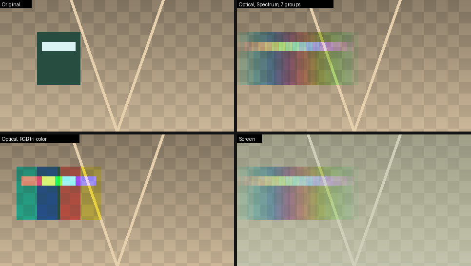
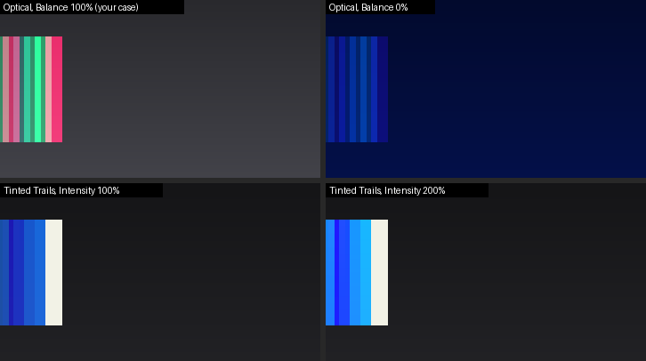

# Bright Times — After Effects plug-in

Временное цветоделение с оптическим наложением кадров (принцип «Harris shutter» /
оптической печати). Эффект берёт целевой кадр и соседние кадры назад и вперёд по
времени (как CC Wide Time), делит их на группы, окрашивает каждую группу своим
цветом с плавным регулируемым затуханием и накладывает. В режиме **Optical**
цветовые фильтры нормируются так, что в сумме дают белый: всё неподвижное
сохраняет исходный цвет, а всё движущееся расслаивается на цветные «призраки».



*Синтетическая сцена из `tools/preview.cpp`: статичный фон остаётся без изменений, движущийся объект раскладывается в спектр.*

## Параметры

| Параметр | Что делает |
|---|---|
| **Frames Backward** | Сколько кадров брать назад (0–50): числовое поле + слайдер, анимируется ключами. |
| **Frames Forward** | Сколько кадров брать вперёд (0–50), независимо от Backward. |
| **Frame Step** | Шаг между взятыми кадрами (1 = соседние, 3 = каждый третий…). |
| **Clip Edges** | *Hold First/Last Frame* — у начала клипа вместо недостающих кадров «назад» берётся первый кадр, у конца вместо кадров «вперёд» — последний (без потемнения); *Transparent* — недостающие кадры прозрачные. |
| **Include Current Frame** | Участвует ли текущий кадр в наложении. |
| **Keep Current Untinted** | Текущий кадр не окрашивается (белый фильтр) и не входит в группы. |
| **Groups & Colors → Number of Groups** | На сколько цветовых групп делятся кадры (1–16). |
| **Group Order** | *Sequential* — группы идут по времени (прошлое → будущее, как радуга на референсе); *Cyclic* — кадры раздаются группам по кругу (классический RGB-«Harris shutter»). |
| **Color Order** | *From Current Frame* (по умолчанию) — Color 1 у текущего кадра, дальше цвета идут наружу, одинаково назад и вперёд; *Past to Future* — Color 1 у самого раннего кадра, последний цвет у самого позднего (радуга через время). |
| **Group Softness** | Плавный переход цвета между соседними группами (0 % — жёсткие ступени). |
| **Color Mode** | *Spectrum* (Hue Start / Hue Range / Saturation), *RGB Tri-Color*, *Custom Palette* (Palette Size + Color 1…6). |
| **Reverse Colors** | Развернуть порядок цветов. |
| **Falloff → Backward / Forward Falloff** | Сила затухания веса кадров с удалением от текущего, отдельно назад и вперёд. |
| **Falloff Curve** | Форма кривой затухания (<1 — быстрый спад сразу, >1 — дальние кадры гаснут резче). |
| **Tint Mode** | *Color Filter* — канал × цвет (как светофильтр); *Luminance Tint* — яркость × цвет. |
| **Blend Mode** | *Optical (Balanced)* — фильтры в сумме дают белый: статичное сохраняет цвет, движение раскладывается в цвета (лучше всего с палитрой, покрывающей R, G и B — спектр, RGB); *Additive*; *Screen*; *Lighten*; *Tinted Trails* — текущий кадр без изменений, копии других кадров добавляются ровно в цветах палитры там, где они ярче текущего (для произвольных палитр, например только синих). |
| **Color Balance** | Только Optical: 100 % — статичные участки точно исходного цвета; меньше — меньше компенсации каналов, цвета ближе к палитре (0 % = Additive). С палитрой без одного из каналов 100 % даёт дополнительные цвета (красные/зелёные края у синей палитры). |
| **Intensity** | Усиление. |
| **Blend With Original** | Как во встроенных эффектах AE: 0 % — полный эффект, 100 % — исходный слой без изменений. |
| **GPU Acceleration** | Вкл. — считать на видеокарте (CUDA / OpenCL / Metal), если в AE включено Mercury GPU Acceleration; выкл. — всегда на CPU. |



*Палитра из трёх синих: Optical со 100 % балансом даёт дополнительные цвета, Tinted Trails — ровно цвета палитры.*

## Как устроено

```
src/
  BrightTimesCore.h        математика: список кадров, цвета групп, веса, накопление (без SDK)
  BrightTimes.cpp/.h       AE SmartFX: параметры, PreRender (checkout кадров), SmartRender CPU/GPU
  BrightTimesPiPL.r        PiPL-ресурс (флаги должны совпадать с GlobalSetup)
  gpu/
    BrightTimesKernels.h   ОДИН исходник ядер для CUDA / OpenCL / Metal
    BrightTimesGPU.*       выбор бэкенда
    BrightTimesCUDA.cu     CUDA (nvcc, статически)
    BrightTimesOpenCL.cpp  OpenCL (компиляция ядра при GPU_DEVICE_SETUP)
    BrightTimesMetal.mm    Metal (компиляция ядра при GPU_DEVICE_SETUP)
tests/                     офлайн-тесты: мок-хост AE + заглушки SDK
tools/preview.cpp          офлайн-превью алгоритма
```

* **SmartFX + Multi-Frame Rendering**, 8 / 16 / 32 bpc на CPU.
* **GPU (32-bit float)**: CUDA, OpenCL, Metal — AE сам выбирает, если в *Project Settings → Video Rendering and Effects* стоит Mercury GPU Acceleration. Если фреймворк не поддержан сборкой (например, DirectX), AE автоматически рендерит на CPU.
* **Premiere Pro**: Premiere не поддерживает SmartFX и GPU-путь After Effects, поэтому там
  работает классический рендер (`PF_Cmd_RENDER`, соседние кадры через `PF_CHECKOUT_PARAM`):
  та же математика на CPU, в родных форматах Premiere: BGRA 32-bit float (когда в последовательности
  включена максимальная глубина / Render at Maximum Depth) или 8 бит. Плагин ставится в ту же папку MediaCore и появляется в обеих программах.
* Время: `PF_OutFlag2_AUTOMATIC_WIDE_TIME_INPUT` — AE сам отслеживает зависимость от соседних кадров для кэша.
* Альфа: прозрачность учитывается корректно (накопление в premultiplied, вывод straight).

## Сборка

Нужен **After Effects SDK 2022 или новее** (developer.adobe.com → After Effects → SDK) и CMake ≥ 3.21.

### Windows (Visual Studio 2022 / 2026)

Нужно: **Visual Studio 2022 или 2026** (бесплатная Community) с нагрузкой
**Desktop development with C++** — CMake входит в неё.
Команды запускать в **Developer PowerShell for VS** (меню Пуск), там `cmake` уже в PATH.
OpenCL-SDK не нужен: плагин сам загружает `OpenCL.dll` из драйвера видеокарты.
Для NVIDIA (AE с Mercury GPU Acceleration **CUDA**) — **CUDA Toolkit**, ставить **после**
Visual Studio, чтобы установилась его интеграция с VS.

1. Склонировать репозиторий и перейти в ветку:
   ```bat
   git clone https://github.com/Velich2/Bright-Times.git
   cd Bright-Times
   git checkout claude/compassionate-goldberg-4jxvsv
   ```
2. Проверить SDK и инструменты (из корня репозитория):
   ```bat
   powershell -ExecutionPolicy Bypass -File tools\check_sdk.ps1 -SdkRoot "C:\Users\Velich\AfterEffectsSDK_26.5_win"
   ```
3. Собрать и установить одной командой (из корня репозитория, **в любом PowerShell** —
   скрипт сам находит CMake внутри Visual Studio и CUDA Toolkit, CUDA включается автоматически):
   ```bat
   powershell -ExecutionPolicy Bypass -File tools\build.ps1
   ```
   После сборки плагин сразу копируется в
   `C:\Program Files\Adobe\Common\Plug-ins\7.0\MediaCore\BrightTimes` — Windows спросит
   права администратора (UAC). Если After Effects открыт, скрипт попросит его закрыть.
   Опции: `-NoInstall` — только собрать; `-Cuda off` — без CUDA; `-SdkRoot <путь>` — другой SDK.
   Если CUDA не настроится, скрипт соберёт плагин без неё (OpenCL-GPU и CPU остаются).

   То же вручную (Developer PowerShell for VS):
   ```bat
   cmake -S . -B build -A x64 -DAE_SDK_ROOT="C:/Users/Velich/AfterEffectsSDK_26.5_win" -DBT_ENABLE_CUDA=ON
   cmake --build build --config Release
   ```

* OpenCL включён по умолчанию и не требует SDK: `OpenCL.dll` загружается во время работы, только если AE выбрал OpenCL.
* `-DBT_ENABLE_CUDA=ON` — нужен CUDA Toolkit; архитектуры выбираются под версию CUDA
  (CUDA 13: RTX 20xx и новее; CUDA 12: ещё GTX 10xx), переопределить — `-DBT_CUDA_ARCHITECTURES=...`.
* PiPL собирается автоматически: `cl /EP` → `PiPLtool.exe` → `.rc`.

Результат: `build/Release/BrightTimes.aex` (при ручной сборке скопировать в
`C:\Program Files\Adobe\Common\Plug-ins\7.0\MediaCore\BrightTimes\`).

### macOS (Xcode)

```sh
cmake -S . -B build -G Xcode -DAE_SDK_ROOT=$HOME/AE_SDK
cmake --build build --config Release
```

Metal включён по умолчанию, бандл универсальный (x86_64 + arm64), PiPL собирается через `Rez`.
Результат: `BrightTimes.plugin` → `/Library/Application Support/Adobe/Common/Plug-ins/7.0/MediaCore/`
(для распространения — подписать/нотаризовать).

После установки: *Effect → Bright Times → Bright Times*.

## Тесты (без After Effects)

```sh
cmake -S . -B build-tests -DBT_BUILD_TESTS=ON
cmake --build build-tests && ctest --test-dir build-tests --output-on-failure
```

* `cpu_host` — мок-хост прогоняет `EffectMain` (GLOBAL_SETUP → PARAMS_SETUP → UPDATE_PARAMS_UI → PRE_RENDER → SMART_RENDER) в 8/16/32 bpc для всех режимов; проверяет совпадение флагов с PiPL, баланс checkout/checkin и что в Optical статичные пиксели не меняются.
* `opencl_host` — тот же путь на GPU через OpenCL (подойдёт и CPU-реализация, например pocl) и сравнение с CPU: расхождение ≤ 2·10⁻⁷.
* `bt_preview <dir>` — рендер синтетической сцены в PPM.

`tests/sdk_stub/` — минимальные собственные заглушки SDK только для тестов; сам плагин всегда собирается с официальным SDK.
