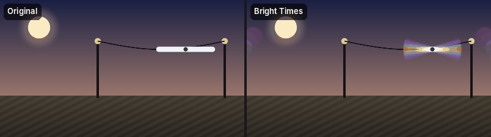
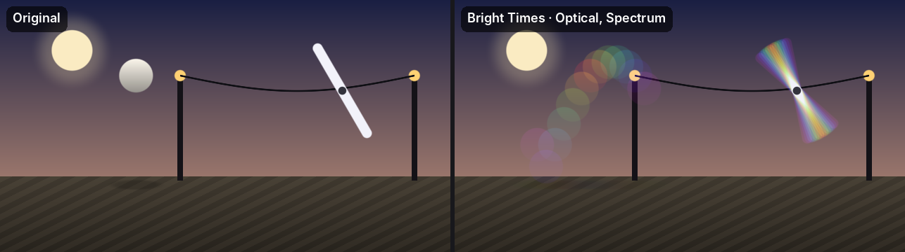
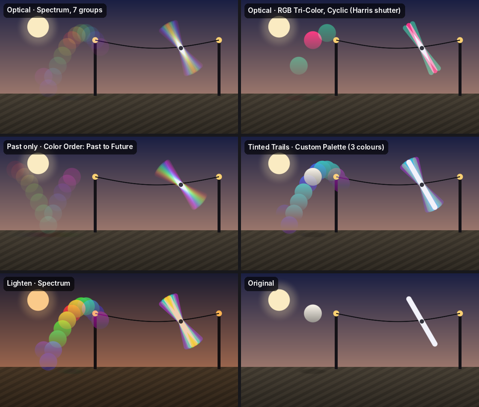

Bright Times — плагин для After Effects и Premiere Pro
=====================================================

Временное цветоделение: эффект берёт соседние кадры назад и вперёд по времени,
окрашивает их по группам с плавным затуханием и оптически накладывает на текущий
кадр. Всё неподвижное сохраняет исходный цвет, движущееся расслаивается на цветные
«призраки».

Подробное описание и исходный код: https://github.com/Velich2/Bright-Times

Установка — Windows
-------------------

1. Закройте After Effects и Premiere Pro.
2. Распакуйте BrightTimes-windows.zip и скопируйте папку BrightTimes (с файлом
   BrightTimes.aex) в
       C:\Program Files\Adobe\Common\Plug-ins\7.0\MediaCore\
   Должно получиться:
       C:\Program Files\Adobe\Common\Plug-ins\7.0\MediaCore\BrightTimes\BrightTimes.aex
3. Запустите программу. Эффект: Effect → Bright Times → Bright Times
   (в Premiere — панель Effects, папка Bright Times).

Если эффект не появился в Premiere Pro, запустите Premiere с зажатой клавишей Shift —
он заново просканирует плагины.

BrightTimes-windows-symbols.zip ставить не нужно: это отладочные файлы для разбора
падений.

Установка — macOS
-----------------

1. Закройте After Effects и Premiere Pro.
2. Распакуйте BrightTimes-macos.zip и скопируйте BrightTimes.plugin в
       /Library/Application Support/Adobe/Common/Plug-ins/7.0/MediaCore/
3. Плагин не подписан, поэтому macOS заблокирует его. Снимите блокировку в Терминале:
       xattr -dr com.apple.quarantine "/Library/Application Support/Adobe/Common/Plug-ins/7.0/MediaCore/BrightTimes.plugin"
4. Запустите программу. Эффект: Effect → Bright Times → Bright Times.

Сборка для macOS (Intel и Apple Silicon, Metal) пока не проверена на реальном Mac.

Видеокарта
----------

- After Effects: GPU используется, если в File → Project Settings → Video Rendering
  and Effects выбран Mercury GPU Acceleration (CUDA, OpenCL или Metal).
- Premiere Pro: GPU — через CUDA (NVIDIA) на Windows и Metal на macOS, если в
  File → Project Settings → General выбран Mercury Playback Engine GPU Acceleration.
- Без GPU эффект считается на процессоре (32-bit float), результат тот же.
- Параметр GPU Acceleration в эффекте выключает видеокарту принудительно.

Проверено: After Effects 26 и Premiere Pro 25 на Windows с NVIDIA.

Быстрый старт
-------------

1. Примените эффект к клипу с движением.
2. Frames Backward / Frames Forward — сколько соседних кадров брать назад и вперёд.
3. Number of Groups и Color Mode — сколько цветов и какие (Spectrum, RGB Tri-Color,
   Custom Palette).
4. Backward / Forward Falloff — насколько слабее дальние кадры.
5. Blend Mode: Optical (Balanced) — неподвижное сохраняет цвет; Tinted Trails —
   следы ровно в цветах палитры (для палитр, например, только из синих).
6. Blend With Original — смешать с исходным клипом (100 % — без эффекта).

Примеры режимов
---------------

Картинки лежат в папке examples рядом с этим файлом.

- Optical · Spectrum — по умолчанию: радуга, неподвижное не меняется.
- RGB Tri-Color, Group Order: Cyclic, Frame Step 3 — классический «Harris shutter».
- Frames Forward 0, Color Order: Past to Future — радужный шлейф только из прошлого.
- Tinted Trails · Custom Palette — следы ровно в цветах палитры.
- Lighten — яркие насыщенные копии поверх кадра.

Если что-то не так
------------------

Диагностический лог (замедляет работу — после проверки выключите).

Windows: в командной строке
    setx BRIGHT_TIMES_LOG 1
затем перезапустите программу. Лог: %TEMP%\BrightTimes.log.
Выключить: setx BRIGHT_TIMES_LOG 0

macOS: в Терминале
    launchctl setenv BRIGHT_TIMES_LOG 1
затем полностью закройте и снова откройте программу. Лог: /tmp/BrightTimes.log.
Выключить: launchctl unsetenv BRIGHT_TIMES_LOG (действует до перезагрузки Mac).

Вопросы и ошибки: https://github.com/Velich2/Bright-Times/issues
